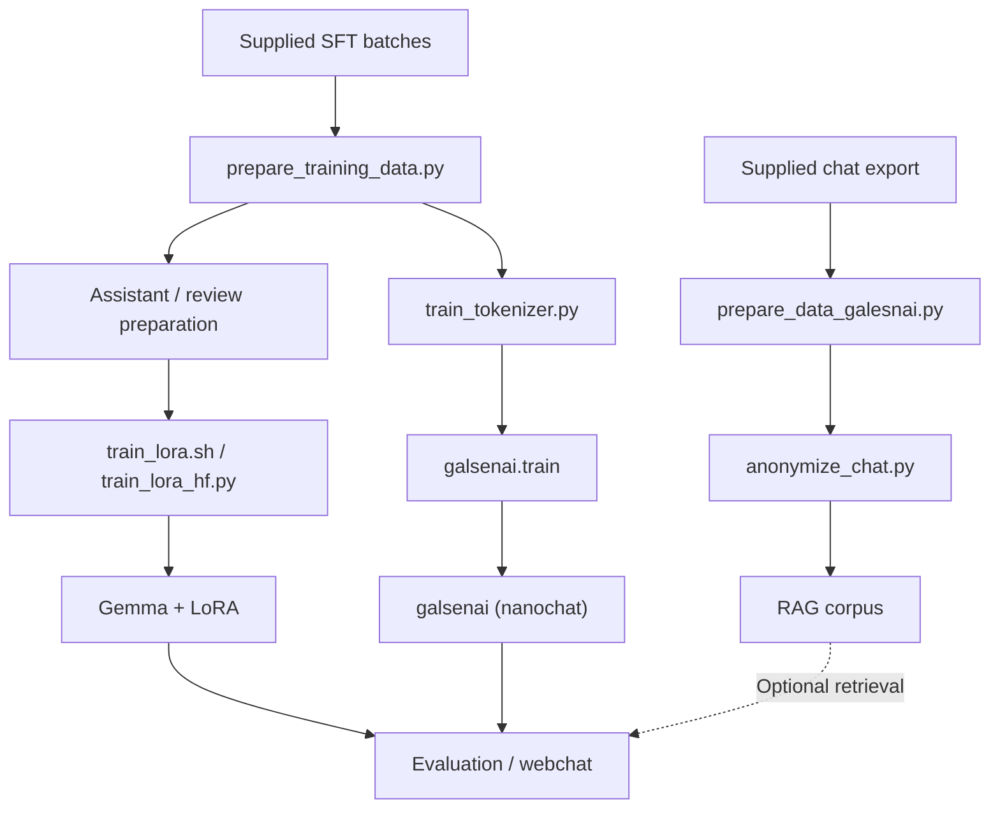

# GalsenAI Underneath

### Unlocking the Knowledge Hidden in Conversations

**From Conversations to Collective Intelligence**
*Turning WhatsApp Q&A Discussions into a Searchable Knowledge Base.*

<p align="center">
  
</p>

A French chat assistant built from GalsenAI discussions. The project compares
Gemma 4 E2B fine-tuning with a compact, nanochat-style transformer trained from
scratch. It includes MLX training on Apple Silicon, Transformers/PEFT training on
CUDA or CPU, evaluation tools and a webchat.

## Pipeline



The public example JSON can be converted separately with
[prepare_sft_mlx.py](scripts/prepare_sft_mlx.py). Complete experiment inputs are
available on request from the GalsenAI community.

## Install

```bash
uv sync --locked --extra dev
uv run --no-sync pytest -q
uv run --no-sync ruff check src tests data/prepare_data_galesnai.py
uv run --no-sync mypy
```

For MLX training and inference on Apple Silicon, use Python 3.12 or newer:

```bash
uv sync --locked --python 3.12 --extra dev --extra mlx
```

Scripts use `.venv/bin/python`; `MLXPY` can select another project environment.

[Linux / Unix training, CUDA and CPU setup](scripts/LINUX_TRAINING.md) (HF training requires Python 3.11+).

## Data

The [public example JSON](data/private/supervised_fine_tuning_galsenai.json)
contains 100 conversations. **Complete datasets and trained adapters are available
on request by contacting the GalsenAI community through this repository, for
example by opening a GitHub issue.** Publication on Hugging Face is planned.

- [Data access and schema](dataset/README.md#data-access-and-schema).
- [Data preparation and privacy](dataset/README.md#data-preparation-and-privacy).
- [Dataset versions and split protocol](data/training_data/PILOT_V2.md).

## Data preparation and privacy

| Information | Treatment |
|---|---|
| Phone numbers | HMAC pseudonyms during preparation; number-like text masked during anonymization |
| Senders and quoted sender names | Random labels; sender mapping is not saved |
| Links, emails and mentions | Replaced with placeholders |
| Dates and times | Reduced to year-month |
| Other names and identifying details | Manual review and optional `--redact-words` list |

Pseudonymization alone does not anonymize the chat. Review identifying details and
source permissions before sharing. See the
[privacy and preparation guide](dataset/README.md#data-preparation-and-privacy).

## Assistant training (current)

[config_gemma.yml](config/config_gemma.yml) configures QAT Gemma LoRA training.
It requires the complete assistant dataset described above.

```bash
./scripts/train_lora.sh
```

Entry points: [MLX training](scripts/train_lora.sh), [CUDA/CPU training](scripts/train_lora_hf.py),
[evaluation](scripts/eval_gemma.py). See [training and evaluation details](scripts/TRAINING.md)
and [reproducing the experiments](scripts/REPRODUCIBILITY.md).

## Chat web app

[serve.sh](scripts/serve.sh) starts the MLX inference API on port 8001 and the
webchat at http://127.0.0.1:8080. Ctrl-C stops both.

The configured model is **Google Gemma 4 E2B IT + v4 LoRA, step 799**. Its adapter
is available on request from the GalsenAI community and will be published on
Hugging Face. Once the adapter is installed at the configured path:

```bash
./scripts/serve.sh
```

To use the Google model without the unpublished adapter:

```bash
ADAPTER=none ./scripts/serve.sh
```

Google model access may require accepting its license and authenticating with
`hf auth login`. Set `MODEL` and `ADAPTER` together for another model/adapter pair.
The webchat disables thinking and uses the shared
[assistant system prompt](config/assistant_system.txt).

## The `galsenai` model (nanochat style)

[galsenai](src/galsenai) is a compact decoder-only transformer trained from scratch,
with about **12M parameters** in the experimental configuration: 6 layers,
6 attention heads and embedding width 384. PyTorch selects CUDA, MPS or CPU.

The model supports RoPE, grouped-query attention, sliding windows and KV caching.
Its nanochat preset uses a ReLU² MLP, QK normalization, parameter-free RMSNorm,
untied embeddings, logit soft-capping and per-layer residual/embedding scales.
SFT computes loss only on assistant tokens; training uses AdamW.

With the requested dataset installed, train the tokenizer and run v2 SFT from
random initialization using the published configuration:

```bash
uv run --no-sync python scripts/train_tokenizer.py --config config/config_nanochat.yml
uv run --no-sync python -m galsenai.train --config config/config_nanochat.yml --stage sft
```

See [training details](scripts/TRAINING.md#other-workflows),
[model configuration](src/galsenai/config.py) and the historical results below.

## Retrieval and other workflows

- [RAG](webapp/rag.py) supports BM25, dense retrieval and hybrid fusion. Supply
  your own corpus through `RAG_CHAT`; dense retrieval requires the `rag` extra.
- [Full fine-tuning and merging](scripts/run_full.sh) and
  [RAG evaluation](scripts/run_eval_rag.sh) are separate historical workflows.
  Their prerequisites are described in the [training guide](scripts/TRAINING.md).

## Results

The current comparison uses **114 development questions**, temperature 0, thinking
disabled, a 512-token output budget and no RAG. Lower BPB/perplexity is better;
higher ROUGE-L and token F1 indicate greater reference overlap.

| Model | BPB ↓ | Perplexity ↓ | ROUGE-L ↑ | Token F1 ↑ | Truncated |
|---|---|---|---|---|---|
| QAT 4-bit + v4, step 400 | 0.6939 | 9.5195 | **0.1765** | **0.2777** | 0/114 |
| Google original, no LoRA | 2.0165 | 698.0617 | 0.0741 | 0.1187 | 105/114 |
| Google + v4, step 550 | 0.6980 | 9.6456 | 0.1675 | 0.2714 | 0/114 |
| Google + v4, step 799 | **0.6811** | **9.1308** | 0.1709 | 0.2697 | 0/114 |

Google step 799 lowers reference perplexity by 4.1% versus QAT, while QAT retains
higher lexical overlap. Google step 799 is the webchat default. These one-seed
development results do not establish factual superiority or isolate quantization's
effect; the unadapted model's high truncation rate also limits interpretation.
[Protocol and limitations](results/google_vs_qat.md).

Historical nanochat comparison, **10 validation turns under a different protocol**:

| Model | BPB ↓ | ROUGE-L ↑ | Token F1 ↑ |
|---|---|---|---|
| Gemma + LoRA, epoch 1 | 0.854 | 0.196 | 0.272 |
| galsenai 12M, chat pretraining + SFT | 1.825 | 0.149 | 0.191 |
| galsenai 12M, SFT only | 2.279 | 0.124 | 0.152 |

The small model trails pretrained Gemma. Chat pretraining exposed source material
behind validation answers, so that row is optimistic. These historical scores are
not directly comparable to the 114-question evaluation.
[Full historical evaluation](results/eval_compare.md).

Further details: [assistant v4 comparison](results/assistant_v4_compare.md),
[aggregate metrics](results/assistant_v4_summary.json),
[discussion statistics](results/STATISTICS.md) and the
[French report](report/rapport_galsenai_underneath.pdf).

## Checks

```bash
uv run --no-sync pytest -q
uv run --no-sync ruff check src tests data/prepare_data_galesnai.py
uv run --no-sync ruff format --check src tests data/prepare_data_galesnai.py
uv run --no-sync mypy
```

Tests cover model behavior, loss masking, training preflight, retrieval caches,
data preparation and anonymization. GPU-specific behavior requires the matching
hardware.

## Attribution

[minbpe](minbpe/) is Andrej Karpathy's tokenizer, distributed under its
[MIT license](minbpe/LICENSE). The model structure follows nanoGPT and nanochat.
