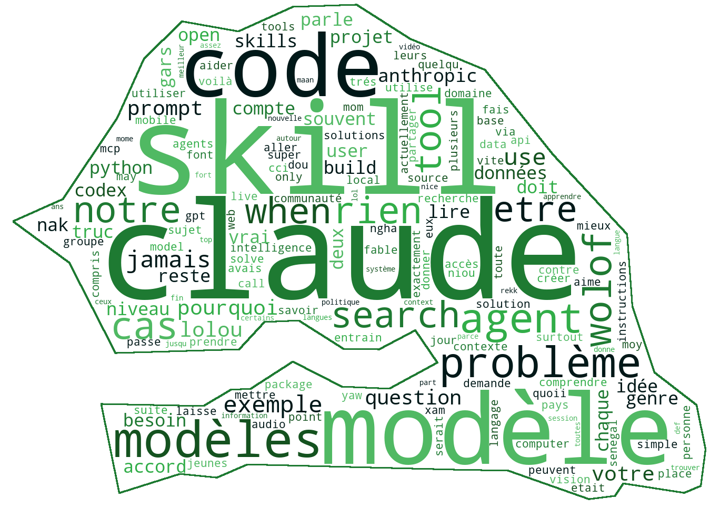

# GalsenAI Underneath

### Unlocking the Knowledge Hidden in Conversations

**From Conversations to Collective Intelligence**

*Turning WhatsApp Q&A Discussions into a Searchable Knowledge Base.*

<p align="center">
  
</p>

Turn the GalsenAI "Questions/Réponses" WhatsApp discussion into a small French chat assistant, and compare two ways
of getting there on one laptop (Apple M5 Pro, 24 GB):

1. **Fine-tune Gemma 4 E2B** with LoRA (MLX).
2. **Train `galsenai`**, a compact nanochat-style decoder-only transformer (12M parameters) from scratch, in this repo.

The historical experiments used 68 training conversations and 8 held-out conversations.
Current assistant training uses the versioned snapshot below.

## Selected inference model

The current local inference model is **Gemma 4 E2B QAT 4-bit + v4 LoRA, step 400**.
Start the inference server and webchat with `./scripts/serve.sh`, then open
http://127.0.0.1:8080. The inference API listens on port 8001. Ctrl-C stops both.
The adapter must already be available locally; weights and private snapshots are not in Git.

The matched 114-question comparison gives v4 step 400 BPB **0.6939**, ROUGE-L **0.1765**
and token F1 **0.2777**, versus v3 **0.6950 / 0.1662 / 0.2731**. V4 has one narrative
flag and no truncated answers. These are modest development gains, not proof of factual
superiority. See [the experiment report](results/assistant_v4_compare.md) and
[aggregate metrics and hashes](results/assistant_v4_summary.json).

## Assistant training (current)

The current Gemma LoRA configuration is `config/config_gemma.yml`.
It uses `data/training_data/pilot_v4_assistant` (799 train, 114 validation),
one epoch (400 steps), rank 8 and learning rate 5e-5. New adapters go to
`data/private/adapters/pilot_v4_assistant/gemma4_e2b_lora_rank8_seed0`.
The v2/v3 snapshots and adapters remain unchanged. V4 replaces eight training answers
using the reviewed correction delivery; two other logged corrections were absent from
the filtered v3 train and are not reintroduced. Questions, system prompt, groups, row
order and the complete validation files are preserved. No corrected evaluation answers
are added to training. `audit.json` records applied and absent UIDs; `manifest.json`
records input/output hashes. The 153 historical candidates are not a new training set.
This is a targeted correction experiment, not a comprehensive quality fix.

```bash
.venv/bin/python -m data.prepare_review_data  # local review delivery required; identical rerun is a no-op
./scripts/train_lora.sh
# Historical v1 training, when its data is available:
CONFIG=config/pilotv1_config/config_gemma.yml ./scripts/train_lora.sh
```

The assistant snapshot keeps the original train/validation assignments. It excludes
415 train / 43 validation `chat_grounded` examples whose excerpts were absent, and
58 train / 10 validation examples with context-dependent language. It does not strip
words out of answers or claim to have rewritten all 1,600 conversations. An audit
records every excluded UID and reason. Six explicit training examples cover agents,
fine-tuning, GalsenAI, assistant identity, unknown events and loss interpretation.
The GalsenAI description was checked against https://galsen.ai/a-propos/ on 2026-11-23.
These synthetic seeds and the filter still require human quality review.

`config/assistant_system.txt` is shared by training data and the webchat. The webchat
disables thinking to preserve the response budget; `SYSTEM_PROMPT` can still override
its system instruction. RAG reports insufficient excerpts without claiming that the
group never discussed a topic. Restart the webchat to apply these changes.

The configuration evaluates and saves every 50 steps. The builder never reads or
exports the v2 test. New seeds have not been audited for semantic overlap with it;
do not claim a clean final benchmark until that exposure audit is done. The 3 debugging
questions used to create the seeds are now training examples, not evaluation items.
Validation loss on this filtered split is not directly comparable to v2 loss.
`scripts/run_eval.sh` still compares base/v2/v3 on assistant validation (commands below);
it does not evaluate v4. The completed v3/v4 checkpoint comparison is documented in
`results/assistant_v4_compare.md`. The webchat now loads v4 step 400 by default.
Other historical evaluation wrappers still use v1 defaults. Do not start another run in the same output directory if its
adapters must be retained; choose a separate `--adapter-path`.
See `data/training_data/PILOT_V2.md` for the data protocol. All three original training
configurations are archived in `config/pilotv1_config/`. The following sections describe
the historical experiments.

## Pipeline

```
WhatsApp export ──► prepare_data_galesnai.py (system lines out, phone numbers → keyed hash)
                └─► anonymize_chat.py (random sender labels, names/links/numbers removed, dates → month)
conversations (data/private/supervised_fine_tuning_galsenai.json, 76 Q&A conversations)
   └─► prepare_sft_mlx.py ──► train.jsonl (68) / valid.jsonl (8)
         ├─► train_lora.sh        Gemma 4 E2B + LoRA            (config/pilotv1_config/config_gemma.yml)
         └─► train_tokenizer.py → galsenai.train base → sft     (config/pilotv1_config/config_nanochat.yml)
                                  └─► run_eval.sh ──► results/local/assistant-eval-*/
                                  └─► webapp/  chat UI on any OpenAI-compatible server (vLLM, mlx_lm.server)
```

Data format: a list of conversations, each a list of `{"role": "user" | "assistant", "content": ...}` turns.

## Install

```bash
uv sync --extra dev          # or: pip install -e ".[dev]"
pytest -q && ruff check . && mypy
```

Gemma fine-tuning and evaluation need [`mlx-lm`](https://github.com/ml-explore/mlx-lm), installed separately
(it is not a project dependency): `uv tool install mlx-lm`.

## Fine-tune Gemma 4 E2B (LoRA)

All hyper-parameters, including the number of **epochs**, are in `config/pilotv1_config/config_gemma.yml`; `train_lora.sh` turns `epochs`
into `--iters` (mlx-lm only knows iterations) and evaluates and saves once per epoch.

```bash
python3 scripts/prepare_sft_mlx.py      # fixed split: 68 train / 8 valid
CONFIG=config/pilotv1_config/config_gemma.yml ./scripts/train_lora.sh
```

Settings that fit 24 GB: LoRA rank 8 on the top 16 layers, batch 2, gradient checkpointing (needed: without it rank 64
with batch 8 runs out of Metal memory). Rank 32 on all layers at learning rate 1e-4 **diverged** (validation loss
3.7 → 6.6), so it is not the default. Validation loss is lowest after **epoch 1** and rises afterwards (overfitting on
68 conversations), so 1–2 epochs is the safer choice than the 5 in the file.

## The `galsenai` model (nanochat style)

A small decoder-only transformer: RMSNorm, RoPE, grouped-query attention, SwiGLU, KV cache, optional sliding-window
layers, LoRA. `ModelConfig.nanochat(vocab_size, ...)` switches on the parts of
[nanochat](https://github.com/karpathy/nanochat)'s GPT: relu² MLP, QK-norm, parameter-free RMSNorm, untied embeddings,
logit soft-cap 15, RoPE base 1e5, SSSL sliding windows, per-layer residual/x0 lambdas. Not ported: value embeddings,
smear gate, FP8, flash-attention, the Muon optimizer (AdamW is used). The chat format is nanochat's (`<|bos|>`,
`<|user_start|>`, `<|assistant_start|>`, ...; loss on assistant tokens only).

```bash
python3 scripts/anonymize_chat.py CHAT.txt data/private/chat_anonymized.txt   # corpus for tokenizer and base stage
python3 scripts/train_tokenizer.py                                            # BPE 2048 + 5 chat specials
python -m galsenai.train --stage base                                         # next-token on chat text
python -m galsenai.train --stage sft                                          # assistant tokens only
python -m galsenai.chat --checkpoint data/private/checkpoints/galsenai_sft.pt \
                        --tokenizer data/private/galsenai_tok/galsenai.model
```

Config and epochs: `config/pilotv1_config/config_nanochat.yml` (override with `--set sft.epochs=3`). Pre-training on the raw chat gives the
model its vocabulary but also lets it see the source of the validation answers (see the evaluation caveats).

```python
import torch
from galsenai import GPT, ModelConfig, generate

model = GPT(ModelConfig.nanochat(vocab_size=2053, n_layer=6, n_head=6, n_embd=384))
tokens = generate(model, torch.tensor([[1, 2, 3]]), max_new_tokens=20, temperature=0.8, top_k=50)
```

| Choice | Why |
|---|---|
| RoPE, no learned positions | Relative positions; no table tied to the training length |
| Grouped-query attention (`n_kv_head`) | KV cache shrinks by `n_head / n_kv_head` (the nanochat preset uses full MHA) |
| Sliding-window layers (`sliding_window`, `global_every`) | Bounded attention cost, interleaved with global layers as in Gemma 3 |
| No biases, KV-cache decoding | Fewer parameters; one new token costs O(1) projections |

The structure follows [nanoGPT](https://github.com/karpathy/nanoGPT) (deprecated upstream in favour of nanochat).

## Evaluation

`./scripts/run_eval.sh` compares the quantized base, v2 LoRA and v3 assistant LoRA on
all 114 turns in `pilot_v3_assistant/valid.jsonl`. Every model uses the shared system
prompt, thinking disabled, temperature 0, repetition penalty 1.1 and a 512-token budget.
RAG is disabled here to isolate the fine-tuning effect. Both adapter directories must exist.

```bash
LIMIT=2 ./scripts/run_eval.sh  # smoke check, 2 turns per model
./scripts/run_eval.sh         # complete validation comparison
```

Each invocation prints its new `results/local/assistant-eval-*/` directory. It contains
`base.json`, `v2.json`, `v3.json`, `comparison.md` and `review.csv` for side-by-side manual
review. Results include data/prompt/adapter hashes, truncation and narrative marker rates.
Existing outputs are never overwritten. `MLXPY` can select the Python environment containing
mlx-lm (default: the local pipx installation). Close the webchat model server before running
the comparison to free memory. These are development results, not a clean final test.
ROUGE/F1 measure word overlap; narrative markers are review flags, not correctness judgments.

The table below is historical: 10 v1 validation turns, different prompts and thinking enabled.
Its scores are not directly comparable to the assistant comparison above.

| Model | Params | BPB ↓ | PPL/token ↓ | ROUGE-L ↑ | Token F1 ↑ | Distinct-2 ↑ | Len ratio | Empty |
|---|---|---|---|---|---|---|---|---|
| Gemma 4 E2B, no fine-tuning | 4629M | 1.130 | 30.6 | 0.082 | 0.144 | 0.86 | 8.37 | 0% |
| Gemma 4 E2B + LoRA, 5 epochs | 4629M | 1.378 | 65.0 | 0.150 | 0.244 | 0.98 | 0.80 | 0% |
| Gemma 4 E2B + LoRA, epoch 1 | 4629M | **0.854** | **13.3** | **0.196** | **0.272** | 0.69 | 0.99 | 0% |
| galsenai 12M, base + SFT | 12M | 1.825 | 65.5 | 0.149 | 0.191 | 0.76 | 0.47 | 0% |
| galsenai 12M, SFT only | 12M | 2.279 | 185.1 | 0.124 | 0.152 | 0.82 | 0.38 | 0% |

How to read it:
- **BPB** (bits per byte of the reference answer) and **PPL/token** score the reference answer under the model. BPB is
  comparable across tokenizers, PPL/token is not.
- **ROUGE-L / Token F1** measure word overlap with the reference. Low absolute values are normal: the references are
  paraphrases of chat opinions.
- **Distinct-2** is the share of unique word bigrams (low means repetition loops). **Len ratio** is generated words
  over reference words: base Gemma is 8x too long, `galsenai` is about half as long as the reference.
- Gemma LoRA at 5 epochs is worse than the untuned model on BPB (1.38 vs 1.13): overfitting. Epoch 1 is the best row on
  every quality metric.

Caveats: 10 turns from 8 conversations, so only large gaps mean something. `galsenai` base + SFT saw the raw chat the
validation answers come from (optimistic); "SFT only" is the leak-free row. Gemma answers with its thinking mode on
(same template as training) and the thought block is stripped before scoring.

## Full fine-tuning and model merging (local)

`config/pilotv1_config/config_gemma_full.yml` trains the real weights of the top 16 blocks of the bf16 `google/gemma-4-E2B-it` (Adafactor, lr 2e-5);
LoRA instead trains small adapters on the 4-bit model. Everything is driven by `scripts/run_full.sh`:

```
./scripts/run_full.sh train                 # add flags to override, e.g. --learning-rate 1e-5 --num-layers -1
./scripts/run_full.sh fuse                  # -> data/private/models/gemma4-full-ft
./scripts/run_full.sh merge 20 40 60 80     # base + full weights: gemma4-full-merge-w<pct> (pct = % of the fine-tuned model)
./scripts/run_full.sh eval                  # validation metrics for every gemma4-full-* model + the bf16 base
```

Every `data/private/models/gemma4-full-*` directory (including the `merge-w<pct>` ones) shows up in the chat app's model picker.
Outputs (`results/*full*`, `results/*merge*`, `data/private/`) are git-ignored. Useful variants: `./scripts/run_full.sh ckpt STEP`
(checkpoint at iteration STEP), `FULL=ep1 ./scripts/run_full.sh merge 40 60` (merge a specific fused model).

Outcome (10 validation turns, table in `results/eval_compare.md`, per-model details in `results/gemma-full-*.json`): full
fine-tuning (BPB 1.083, val loss 3.42 vs 2.66 for LoRA) overfits after 1 epoch, and training all blocks diverges. Merging with
the base helps: `merge-w40` BPB 0.864, `merge-w60` ROUGE-L 0.163 / F1 0.235. None beats `gemma-lora-1ep` (BPB 0.854,
ROUGE-L 0.196, F1 0.272), so LoRA stays the served model. Knowledge retention is not measured by these metrics.

## RAG (retrieval over the anonymized chat)

`webapp/rag.py` indexes `data/private/chat_anonymized_v2_rag.txt` (windows of 4 messages) with BM25, `google/embeddinggemma-2`
(text only, `pip install -e .[rag]`) or both (reciprocal rank fusion). The chat app has a RAG selector; passages are injected
in the last user turn and shown under the answer. `scripts/rag_contexts.py` scores retrieval (hit@k, MRR, context recall, chunk
sizes), `scripts/run_eval_rag.sh` evaluates Gemma + RAG on the validation turns, `scripts/eval_rag.py` runs hand-written questions.
Dense cache filenames include the indexed content hash, so old v1 vectors are not reused.
`RAG_CHAT` can override the corpus path. Restart the webchat to load the selected corpus.
The RAG evaluation wrappers remain historical v1 workflows, separate from `run_eval.sh`;
their results go to `results/local/` and `results/eval_compare.md`.

## Chat web app

`webapp/` is a minimal chat UI (GalsenAI logo and colours: green top bar and footer, white conversation area, left
panel listing the group's themes; a click sends a natural question to the model) with a model picker (`galsenai-gemma`: any OpenAI-compatible server; `galsenai-nanochat`: the 12M checkpoint, generated in-process) and ChatGPT-style rendered Markdown answers. vLLM needs a GPU machine; on the Mac
`./scripts/serve.sh` starts `mlx_lm.server` with the selected LoRA adapter and the web app together (Ctrl-C stops both):

The default adapter is `data/private/adapters/pilot_v4_assistant/gemma4_e2b_lora_rank8_seed0`.
Set `ADAPTER` to serve a different checkpoint; the active adapter directory is shown in the UI.
The script exits if adapter files are missing. Use `ADAPTER=none ./scripts/serve.sh`
when you explicitly want the base model. Thinking is disabled in webchat requests;
the UI temperature remains configurable, while evaluations used temperature 0.

```bash
./scripts/serve.sh                      # then open http://127.0.0.1:8080
# GPU machine instead
vllm serve google/gemma-4-E2B-it --port 8000
VLLM_BASE_URL=http://HOST:8000/v1 .venv/bin/python webapp/server.py
```

With `mlx_lm.server` the request model name must be `default_model` to use the preloaded model and its adapter (`serve.sh`
sets it and passes the real name to the UI via `ACTIVE_MODEL`); any other name loads that model without the adapter.

Optional environment variables: `MODEL`, `SYSTEM_PROMPT`, `API_KEY`. Standard library only.

## Report

The discussion statistics (themes, top voices, word cloud) are in [`results/STATISTICS.md`](results/STATISTICS.md).

`report/rapport_galsenai_underneath.pdf` is the only report file in the repository (3 pages, French: cover with a map of
Senegal and the GalsenAI logo, what was built, results, discussion statistics). Its LaTeX sources (`report/*.tex`, `assets/`) are **kept local and git-ignored**; `senegal.tex` is generated by
`scripts/make_senegal_map.py` and `stats_data.tex` by `scripts/chat_figures.py`.

Rebuild: `python3 scripts/make_senegal_map.py`, `uv run --no-project --with wordcloud python scripts/chat_figures.py`,
then `cd report && latexmk -xelatex main.tex`.

## Tests

`tests/` checks properties, not implementation: causality, KV-cache equals full forward (including the nanochat
variant), sliding-window receptive field, RoPE relative-position invariance, parameter count, loss masking,
memorization of a short sequence, sampling filters, checkpoint round trip, LoRA identity at initialization, the chat
format and assistant-only mask, and the anonymizer.

## Data preparation and privacy

- `data/prepare_data_galesnai.py` removes WhatsApp system lines and replaces every phone number with an HMAC-SHA256
  token (`TEL_ab12cd34`) under a secret local key. The key and the token-to-number table live in `data/private/` and
  never leave the machine. Display names are **not** anonymized by this step.
- `scripts/anonymize_chat.py` is the step before sharing text. Two layers of protection exist and they are not the
  same thing: pseudonymization (the `TEL_` tokens, reversible by whoever holds the key) and anonymization (this script,
  where nothing is kept that links back to a person).

  | In the text | Treatment |
  |---|---|
  | Sender (display name or `TEL_` token) | Random label `U01`, `U02`, ... drawn fresh each run; **the mapping is never written** |
  | The same names or `TEL_` tokens quoted inside messages | Same label as the sender, so threads stay readable |
  | Links, e-mails, `@mentions`, phone-like numbers | `[lien]`, `[email]`, `[mention]`, `[numero]` |
  | Date and time | Year-month only |
  | Other people's names in free text, extra identifying details | **Not detected**: pass them with `--redact-words` |

  Dropping the mapping table makes re-identification harder but does not make the data anonymous: in a community of
  about 100 members, an opinion, a job or a writing style can identify someone. Before sharing outside the group,
  proofread a sample, remove very personal messages, and get the administrators' consent. Under GDPR, data that is
  only pseudonymized is still personal data. This is not legal advice.

  ```bash
  python3 scripts/anonymize_chat.py data/whatsapp_questions_reponses/CHAT.txt data/private/chat_anonymized.txt
  python3 scripts/anonymize_chat.py CHAT.txt OUT.txt --redact-words names.txt   # one word or name per line
  ```

  The anonymized file is also the corpus the `galsenai` tokenizer and base stage train on.
- Raw exports, media, backups, trained adapters and checkpoints are git-ignored. Model outputs in `results/` quote the
  chat: do not publish them from a public repository without review.

```bash
python data/prepare_data_galesnai.py --dry-run   # count only
python data/prepare_data_galesnai.py             # backup, filter, pseudonymize
```

## Roadmap

1. Pick the Gemma epoch count on a larger validation set, and add more conversations (76 is small).
2. Export: weight quantization (int8/int4), then LiteRT or GGUF, with an accuracy check against the PyTorch model.
3. Measure on-device memory and tokens/second on a real phone.

## Attribution

`minbpe/` is Andrej Karpathy's tokenizer (MIT, see `minbpe/LICENSE`). The model structure follows nanoGPT and nanochat
(Karpathy, MIT). The course notebooks in `legacy/` come from Imad Saddik's "Train your language model" course; check
its license before redistributing any course material.

## Data access and schema

The published example dataset is
[`data/private/supervised_fine_tuning_galsenai.json`](data/private/supervised_fine_tuning_galsenai.json),
with **100 conversations** (89 `complementary`, 11 `chat_grounded`). The directory name
is historical: this specific file is intentionally public. It is not the complete
corpus used to train v4, and its publication does not certify every answer.

Each JSON record contains:

| Field | Meaning |
|---|---|
| `id` | Example identifier within the source file |
| `type` | Example category, such as `complementary` or `chat_grounded` |
| `group_id` | Group of related examples, used to keep related records together |
| `source_lines` | Source references, including `{file, start, end}` ranges when available |
| `external_sources` | External references, when available |
| `messages` | Ordered conversation turns with `role` and `content` |

Source references do not include the underlying private conversations. Some grounded
examples need those excerpts to be useful; they must not be treated as standalone
assistant training targets without checking their context.

The generated batches and full training/validation/test datasets are **not published
in this Git repository**. For access, contact the maintainer through this repository
(for example, open a GitHub issue). A Hugging Face dataset release is planned soon;
no download URL is announced yet.

Public preparation material in `data/training_data/` consists of:

- `assistant_seed_examples.json`: six explicit examples with `id`, `theme`, `question`
  and `answer`; optional `source` and `checked_on` document a factual check.
- `collection.json` and `collection_v2.json`: collection seed, source filenames and
  themes, collection targets, and optional split method/ratios. Targets are not counts
  of delivered examples.
- `pilot_v2_summary.json`: historical split/theme/type counts and SHA-256 fingerprints,
  without conversations. Source labels use `../filename.json`; original hash values
  are preserved, even when local source files have since been corrected.
- `PILOT_V2.md`: differences between the public dataset, historical pilots and current
  assistant snapshots, plus preparation and evaluation limitations.

The `../filename.json` source labels are portable identifiers. Supply the real local
source directory using `--source-dir PATH` or `GALSENAI_SOURCE_DIR`; they do not expose
its private location. For example, with the source files available locally:

```bash
.venv/bin/python -m data.prepare_training_data \
  --config data/training_data/collection_v2.json \
  --source-dir /path/to/source-files \
  --output data/training_data/new_snapshot
```

Use a new output directory. Existing v2/v3/v4 snapshots remain frozen; the source-label
change does not rewrite their manifests or make current corrected inputs identical to
historical inputs.

## Git contents

Commit code, configuration, tests, methodology, aggregate experiment summaries, the
public dataset above, and the explicitly listed preparation files. Keep all other
`data/private/` content (including generated batches), `data/legacy/`, `data/backups/`,
training snapshots, adapters, checkpoints, correction deliveries and `results/local/`
out of Git. The `.gitignore` explicitly permits the public dataset and preparation
files. Do not run the previously suggested `git rm --cached` on the public dataset.
New top-level evaluation JSON files are ignored except `results/assistant_v4_summary.json`
and `results/chat_stats.json`. Ignore rules do not remove already tracked files.
